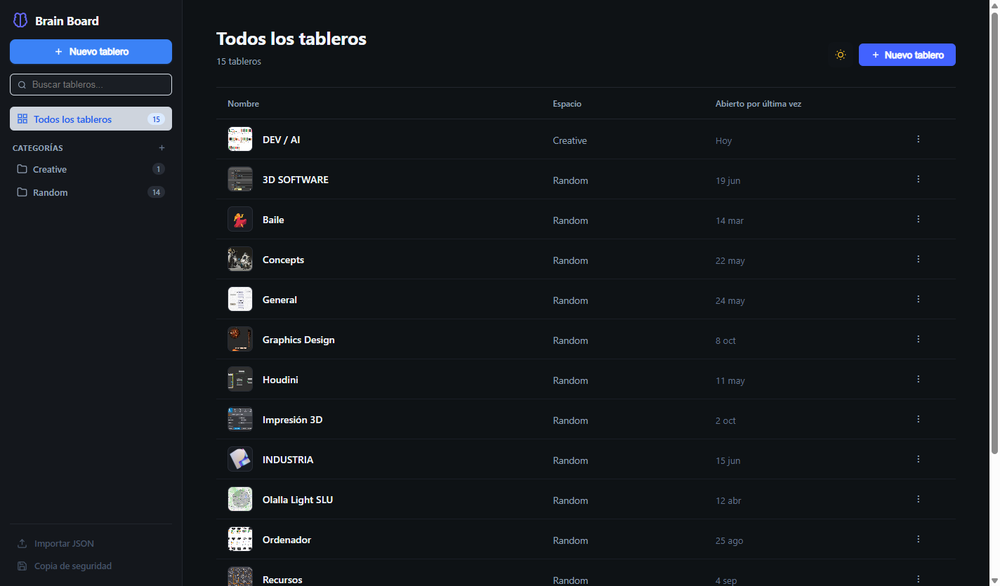
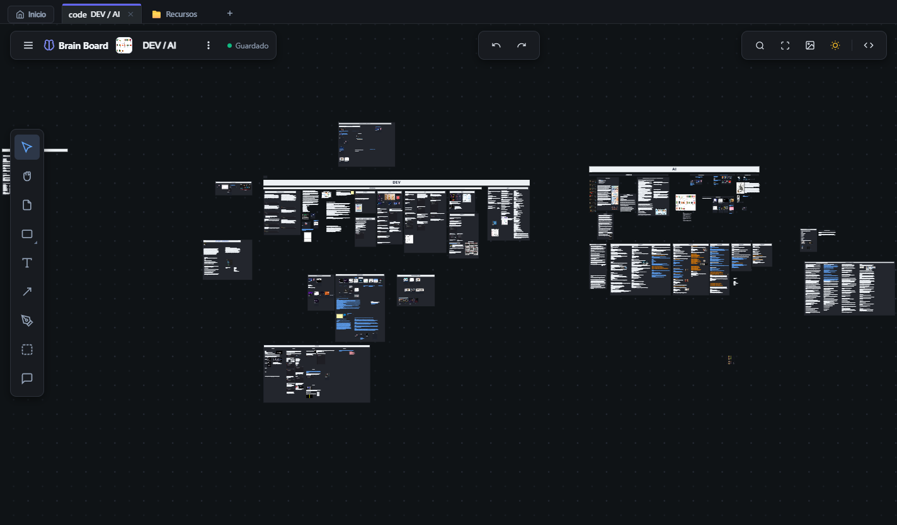
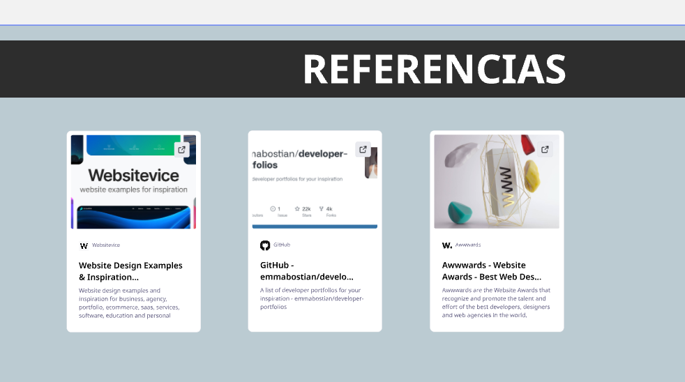
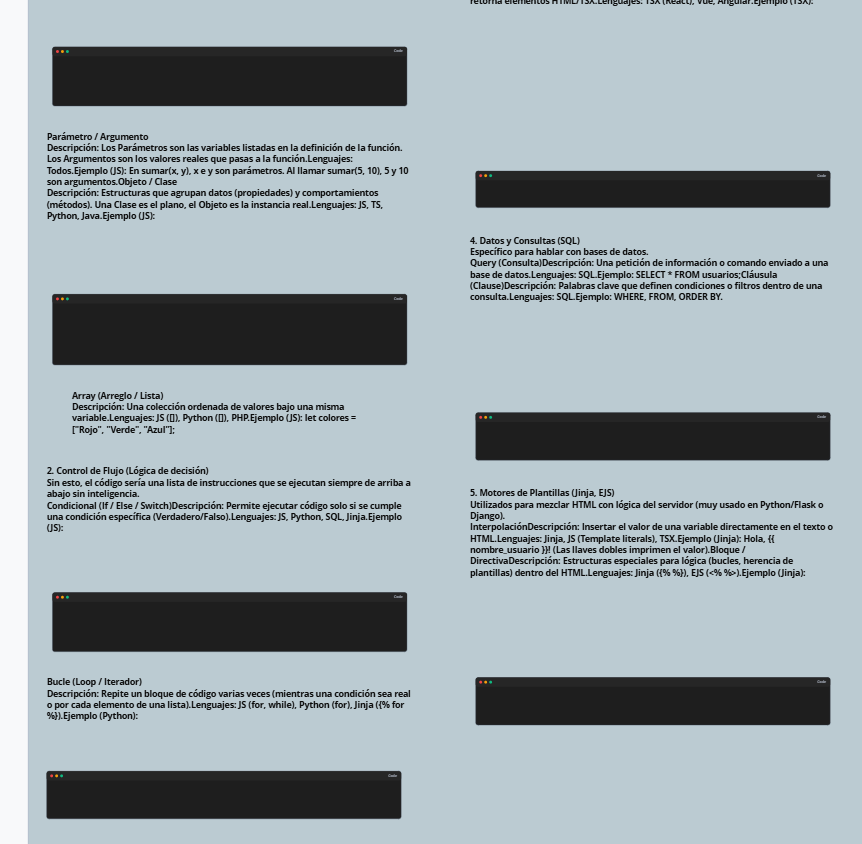

# 🧠 Brain Board

<p align="center">
  
</p>

<p align="center">
  <strong>La pizarra digital infinita, 100% offline, ultrarrápida y privada para mentes creativas, ingenieros y desarrolladores.</strong>
</p>

<p align="center">
  
  
  
  
  
</p>

---

## ✨ ¿Qué es Brain Board?

**Brain Board** es un entorno de trabajo visual infinito para escritorio diseñado desde cero para ser **completamente local, rápido y sin dependencias de la nube**. Olvídate de suscripciones mensuales, caídas de servidores o pérdidas de privacidad: todos tus tableros, notas, esquemas, tarjetas interactivas y galerías de imágenes residen exclusivamente en tu propio disco duro.

Con un motor gráfico 2D acelerado por hardware capaz de gestionar miles de elementos sin tirones a 60 FPS, Brain Board combina la libertad de una pizarra física con la potencia de un gestor de proyectos visual para arquitectura de software, diseño de sistemas, diagramación y documentación técnica.

---

## 📸 Capturas de Pantalla

### 🗂️ 1. Pantalla de Inicio y Gestor de Tableros
Administra decenas de tableros organizados en categorías y espacios de trabajo, con búsqueda instantánea y accesos directos:

<p align="center">
  
</p>

---

### 🎨 2. Espacio de Trabajo Infinito con Pestañas
Navega entre múltiples tableros a la vez gracias a la barra superior de pestañas multitarea. El lienzo infinito cuenta con una **cuadrícula adaptativa multinivel** que conserva la orientación y escala incluso al alejar la vista al máximo:

<p align="center">
  
</p>

---

### 🔗 3. Tarjetas Web Enriquecidas y Enlaces Multimedia
Pega cualquier URL (YouTube, GitHub, artículos, documentación) y se convertirá en una tarjeta widget interactiva con portada en alta resolución, favicon del sitio y botón de apertura externa:

<p align="center">
  
</p>

---

### 💻 4. Bloques de Código Fuente y Notas Estructuradas
Inserta fragmentos de código limpios con diseño oscuro y tipografía monoespaciada para tus referencias técnicas, algoritmos o configuraciones:

<p align="center">
  
</p>

---

## ⚡ Características Principales

### 🚀 Rendimiento Extremo y Motor Gráfico Personalizado
* **Canvas 2D optimizado:** Renderizado a 60+ FPS con frustum culling inteligente. Solo se dibujan los elementos presentes en el viewport del usuario.
* **Cuadrícula de puntos adaptativa:** El fondo punteado ajusta dinámicamente su densidad y nivel de detalle al hacer zoom in o zoom out, manteniendo siempre una referencia espacial limpia y elegante.
* **Minimapa interactivo:** Vista panorámica flotante para saltar rápidamente a cualquier sección de tableros gigantes.

### 🛡️ Persistencia Dual y Trabajo Seguro
* **100% Offline y Privado:** Sin registros, sin telemetría y sin conexiones forzadas a servicios de terceros.
* **Doble salvaguarda de datos:** Cada cambio que realizas se guarda al instante tanto en el almacenamiento de alto rendimiento de `IndexedDB` como directamente en archivos físicos `.json` en disco (`boards/*.json`).
* **Protección sagrada de modificaciones:** Tus cambios manuales quedan permanentemente preservados gracias a la verificación de integridad de usuario.

### 📋 Portapapeles Inteligente de Nueva Generación
* **Pegar imágenes externas (`Ctrl + V`):** Haz clic derecho en cualquier imagen de Google o tu navegador, pulsa *Copiar imagen* y pégala directamente en el tablero bajo tu ratón. También compatible con capturas (`Win + Shift + S`) y programas de diseño.
* **Autodetección de enlaces y vídeos:** Al pegar un enlace de YouTube, se extrae de inmediato la miniatura y el título oficial del vídeo.
* **Miniaturas offline:** Para páginas web convencionales, Brain Board consulta los metadatos Open Graph (`og:image`) y convierte la imagen a Base64 local, de modo que las portadas continúan mostrándose incluso si te desconectas de internet.
* **Arrastrar y soltar (Drag & Drop):** Arrastra imágenes o enlaces directamente desde tu navegador o desde el explorador de archivos de Windows y suéltalos en la pizarra.
* **Duplicación rápida con rueda del ratón:** Con uno o más elementos seleccionados, pulsa y arrastra con la rueda central del ratón (`Middle Click`) para clonarlos y colocarlos exactamente donde quieras. Si pulsas en una zona vacía, navegas por el lienzo con total suavidad.

### 🛠️ Herramientas de Creación Visual
* **Notas adhesivas:** Notas rápidas con autoajuste de texto y colores variados.
* **Formas geométricas inteligentes:** Rectángulos, círculos, rombos, triángulos y estrellas con control de color de fondo y borde.
* **Conectores y diagramas de flujo:** Flechas inteligentes rectas u ortogonales con imantación magnética a los bordes de cualquier objeto.
* **Marcos organizadores (Frames):** Agrupa secciones completas de tu mapa conceptual para moverlas o estructurarlas como un bloque único.
* **Herramienta de pluma (Pen):** Trazos libres y anotaciones a mano alzada.
* **Exportación Ultra HD (4K):** Exporta capturas de tu tablero completo o selecciones en altísima resolución PNG con un solo clic.

---

## ⌨️ Atajos de Teclado

| Atajo | Acción |
| :--- | :--- |
| **`V`** | Herramienta de Selección |
| **`H`** | Herramienta Mano (Desplazamiento / Pan) |
| **`N`** | Crear Nota Adhesiva (Sticky note) |
| **`S`** | Crear Forma Geométrica |
| **`T`** | Crear Bloque de Texto |
| **`L`** | Conector / Flecha entre elementos |
| **`P`** | Lápiz / Pluma a mano alzada |
| **`F`** | Crear Marco de agrupación (Frame) |
| **`Ctrl + C` / `Ctrl + V`** | Copiar y Pegar elementos, imágenes o enlaces |
| **`Ctrl + D`** | Duplicar elementos seleccionados |
| **`Clic Central (Arrastrar)`** | Duplicar y mover elementos seleccionados / Paneo de cámara |
| **`Ctrl + Z` / `Ctrl + Y`** | Deshacer / Rehacer |
| **`Ctrl + A`** | Seleccionar todo el lienzo |
| **`Enter`** | Entrar en modo edición de texto del objeto seleccionado |
| **`Supr` / `Retroceso`** | Eliminar objetos seleccionados |
| **`Doble Clic` / `↗`** | Abrir enlace web de tarjetas o widgets en tu navegador |

---

## 🚀 Instalación y Puesta en Marcha

### Prerrequisitos
* [Node.js](https://nodejs.org/) (versión 18 o superior recomendada).
* Git instalado en el equipo.

### 1. Clonar el repositorio
```bash
git clone https://github.com/tu-usuario/BrainBoard.git
cd BrainBoard
```

### 2. Instalar dependencias
```bash
npm install
```

### 3. Ejecutar en modo desarrollo
```bash
npm start
```
*Electron iniciará la aplicación de escritorio de forma instantánea.*

### 4. Compilar paquete distribuible (.asar)
```bash
npm run build
```
*Genera el paquete optimizado en `dist/app.asar` listo para distribución.*

---

## 📂 Estructura del Proyecto

```
BrainBoard/
├── app_bundle/                 # Shell de la aplicación y proceso Electron
│   ├── main.js                 # Proceso principal de Electron (seguridad, ventanas, IPC)
│   ├── index.html              # Estructura del Dashboard de inicio y lienzo Canvas
│   ├── preload/                # Puente de APIs seguras y portapapeles nativo
│   └── whiteboard/
│       ├── board_app.js        # Controlador de la UI, gestión de tableros y eventos
│       ├── canvas_engine.js    # Motor gráfico de renderizado Canvas 2D
│       └── whiteboard.css      # Estilos modernos de la interfaz y modo oscuro
├── boards/                     # Archivos fuente JSON de los tableros persistentes
├── docs/
│   └── screenshots/            # Galería de imágenes y capturas para documentación
├── scripts/
│   └── pack_asar.js            # Script automatizado de empaquetado para distribución
├── package.json
└── README.md
```

---

## 📄 Licencia

Este proyecto está bajo la Licencia **MIT**. Puedes usarlo, modificarlo y distribuirlo libremente para tus proyectos personales o profesionales.
